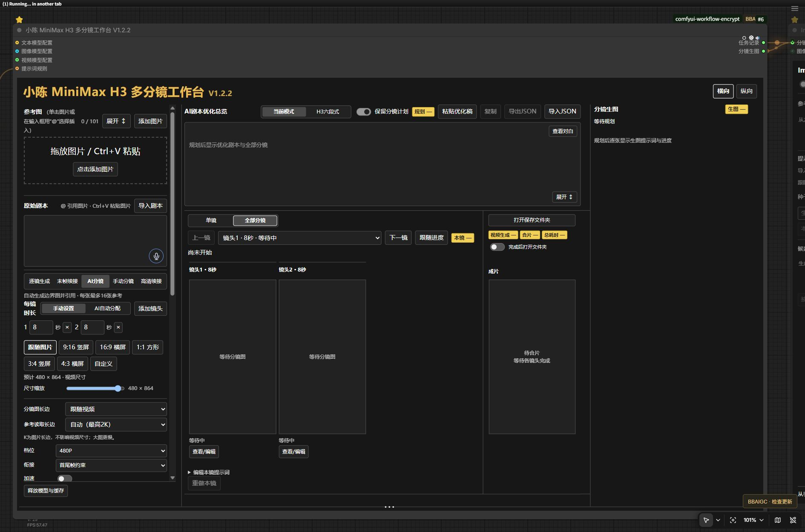

<div align="center">

# BBAIGC MiniMax H3 小陈工作台

### 一句话规划分镜 · 连续镜头生成 · 本地视频制作


[快速安装](#智能体开箱即用--复制即装) · [模型下载](MODELS.md) · [安装提示词](AGENT_INSTALL.md) · [版本清单](release.json)

</div>

**从一句话或完整剧本开始，规划镜头、整理提示词，按顺序生成并合成视频。** 需要掌控画面时可使用自己的分镜图；需要减少手工操作时可启用 AI 分镜与自动生图。镜头、参考图和结果集中管理，便于逐项调整与重新生成。



> 当前截图展示工作流与操作布局，不代表特定题材的生成效果。

## 一条流程完成哪些事

| 环节 | 工作台能力 |
|---|---|
| 故事与分镜 | 本地语言模型规划镜头、分配内容，保留可编辑分镜计划 |
| 提示词 | 按模型规则优化视频提示词，支持前置规则与逐镜调整 |
| 参考图 | 多图集中上传、按编号引用，首帧/尾帧与镜头关联 |
| 分镜生图 | 可用 Qwen Image 2.1 生成分镜，也能逐镜上传自己的图片 |
| 连续生成 | 顺序处理镜头与衔接，减少并行加载带来的资源压力 |
| 音轨与字幕 | 可选配音、音色分配与字幕处理；按启用能力准备相应依赖 |
| 复用与重做 | 导入已有分镜计划、针对镜头修改或重新生成，保留已完成进度 |
| 独立语音输入 | 共享节点包内含语音转文字节点，可按需添加并接入文本入口 |

面板支持拖放参考图与 **Ctrl＋滚轮** 缩放；只安装一份共享节点，图片工作台可共同使用。

## 五种镜头组织方式

| 模式 | 适合场景 |
|---|---|
| 逐镜参考图 | 每个镜头有明确的画面设计 |
| 上一镜末帧 | 需要承接前一镜最后画面的连续镜头 |
| AI 生成分镜 | 从想法或剧本出发，减少手工准备图片 |
| 手动分镜图 | 已在其他工具绘制或生成分镜 |
| 末帧高清续接 | 以高清处理后的末帧继续后续镜头 |

“一句话自动生成”需要已安装并选好语言模型、图像模型与视频模型。自动规划会减少步骤，最终画面与音频仍取决于模型能力；不会承诺角色永远一致或台词逐字准确。

## 智能体开箱即用 · 复制即装

支持 **Codex、Claude Code、Cursor、Windsurf、Trae、通义灵码、CodeBuddy** 等具备本地工具权限的智能体。点击代码块右上角复制按钮，粘贴后即可交给智能体完成环境识别、依赖安装、模型下载与部署检查。

<details>
<summary><strong>智能体开箱即用 · 复制即装</strong></summary>

```text
请在我的电脑上安装 BBAIGC「MiniMax H3 小陈工作台」。
仓库：https://github.com/BBAIGC/ComfyUI-BBAIGC-MiniMax-H3

先读取仓库的 README.md、MODELS.md、AGENT_INSTALL.md 和 release.json，再按照 AGENT_INSTALL.md 的完整步骤直接完成部署。自动找到我实际使用的 ComfyUI、Python 环境、模型与用户目录，保留现有模型、提示词、密钥和输出。复用已安装的共享节点，避免重复注册；按 MODELS.md 的来源、精确文件名、大小和位置下载真正需要的模型。不要盲目重装或降级已可工作的 PyTorch，不要把私有密钥写入工作流或上传仓库。
如果尚未指定模型方案，请在识别硬件后一次性让我选择：A作者同款（图片UC Q6_K与作者配套编码器/VAE，H3采用有公开来源的基础INT8+官方8步LoRA）；B按本机显存/内存适配的同架构量化；C高配更高精度；D作者同款再加一个适配版本。说明各方案的真实下载体积、兼容性和取舍后再下载；我已明确指定时直接按指定方案，禁止默认全部下载。
完成依赖、工作流部署和无付费、无推理的加载检查，告诉我实际安装位置、版本、可用入口与缺失项。需要登录、验证码或接受模型许可时再让我操作；其他可自动完成的部分直接继续。
```

[完整安装提示词与细节 →](AGENT_INSTALL.md)

</details>

也可手动安装：先阅读 [模型与节点清单](MODELS.md)，将节点仓库安装到当前 ComfyUI 的 `custom_nodes`，在对应 Python 环境安装 `requirements.txt`，把公开工作流导入 `user/default/workflows/BBAIGC`，随后重启并检查是否缺失节点。图片工作流仓库是工作流包，实际共享运行节点来自 H3 仓库。

## 命令安装

推荐先使用上面的智能体安装提示词。以下 PowerShell 示例需将三个路径改成当前实例的真实位置：`ComfyCore` 含 `folder_paths.py`，`ComfyBase` 含实例的 `custom_nodes/models/user`，`ComfyPython` 是运行它的 Python。Desktop、便携版与手工安装不能混用环境。

```powershell
$ComfyCore = 'C:\ComfyUI\ComfyUI'
$ComfyBase = 'C:\ComfyUI'
$ComfyPython = 'C:\ComfyUI\.venv\Scripts\python.exe'
git clone https://github.com/BBAIGC/ComfyUI-BBAIGC-MiniMax-H3
& $ComfyPython ".\ComfyUI-BBAIGC-MiniMax-H3\install.py" --comfy-root $ComfyCore --base-dir $ComfyBase --download-models h3 --with-speech
```

安装器保留已有用户工作流与密钥，复用同一来源的节点，先检查已有 PyTorch 栈再安装依赖。首次没有选定量化时先读 [模型档位](MODELS.md)，不要直接下载所有模型。将 `--download-models` 改为 `none` 可只装节点与工作流；`speech`、`qwen-turbo`、`krea`、`h3` 是相应模型组合，`--with-speech` 额外补齐语音四文件。下载组合只决定文件下载，不会擅自改动现有工作流的模型选择；打开后按所选模型切换路线并检查文件名。

`h3` 组合不包含图片生成三件套与 Ollama。要使用自动分镜生图，再按 [MODELS.md](MODELS.md) 安装作者同款图片模型或选定的量化方案；已有参考图片的视频路线可跳过本地分镜生图模型。

## 模型与环境

作者设备：**RTX 5060 Ti 16GB · i7-12700KF · 64GB 内存**。H3 官方基础四件套约 **40.07 GB**，加一份官方加速 LoRA 约 **42.03 GB**。这是磁盘占用，模型通过内存卸载运行，不能把文件总大小当作显存要求。完整 AI 分镜另需 Qwen 图片三件套与 Ollama；语音模型另选。详细文件、量化档位、目录与下载命令见 [MODELS.md](MODELS.md)。

公开默认采用有明确下载来源的官方基础模型与加速 LoRA。稀疏注意力、分块低显存、参考视频与本地配音均为按需组件，不能把未安装的可选插件误当成基础功能故障。

> **作者暂估，待固定参数实测替换：** 加速方案生成约 1 分钟视频，大约需要 30 多分钟；未加速方案生成约 15 秒视频，大约需要 13 分钟。这两项不是同参数对照测试，不能按比例外推。分辨率、镜头数、步数、音轨和内存卸载都会影响耗时。

## 上游与依赖

| 组件 | 来源 | 是否必需 |
|---|---|---|
| MiniMax H3 原生模型与节点 | [ComfyUI](https://github.com/Comfy-Org/ComfyUI) · [MiniMaxAI](https://huggingface.co/MiniMaxAI/MiniMax-H3) | 视频生成需要 |
| Ollama | [ollama.com](https://ollama.com) | AI 分镜/提示词规划需要 |
| GGUF 加载 | [city96/ComfyUI-GGUF](https://github.com/city96/ComfyUI-GGUF) | 使用 GGUF 图片模型时需要 |
| 分块低显存节点 | [kijai/ComfyUI-KJNodes](https://github.com/kijai/ComfyUI-KJNodes) | 启用对应策略时需要 |
| H3 稀疏注意力 | [ethanfel/ComfyUI-PlagueKind-Nodes-only-sparse](https://github.com/ethanfel/ComfyUI-PlagueKind-Nodes-only-sparse) | 可选加速 |
| AI-Toolkit 参考视频预处理 | [ostris/ComfyUI-AIToolkit-MiniMaxH3](https://github.com/ostris/ComfyUI-AIToolkit-MiniMaxH3) | 参考视频扩展路线可选，当前主工作流未直接引用该节点 |
| Qwen 本地配音 | [flybirdxx/ComfyUI-Qwen-TTS](https://github.com/flybirdxx/ComfyUI-Qwen-TTS) | 可选 |

AI-Toolkit 组件用于与训练时的参考视频预处理对齐，包括 24fps 采样与模型帧网格；它不替代 H3 模型。保留所有上游组件的许可与署名。

## 更新

工作台版本与发布下载入口见 [release.json](release.json)。更新共享节点时，图片与视频工作台会同时使用更新后的核心；请保留自己的 JSON 与本机配置。公开仓库不包含模型权重、API Key、私人参考图或生成记录。

## 联系与支持

有问题可通过 [Issues](https://github.com/BBAIGC/ComfyUI-BBAIGC-MiniMax-H3/issues) 反馈，附工作流版本、模型名称和脱敏后的错误信息。

<table>
<tr><th>联系作者</th><th>微信支持</th><th>支付宝支持</th></tr>
<tr>
<td align="center"></td>
<td align="center"></td>
<td align="center"></td>
</tr>
</table>

模型、依赖插件与本项目各自遵循其许可证。BBAIGC 提供工作台与流程整合，上游模型及节点作者保留各自署名。
